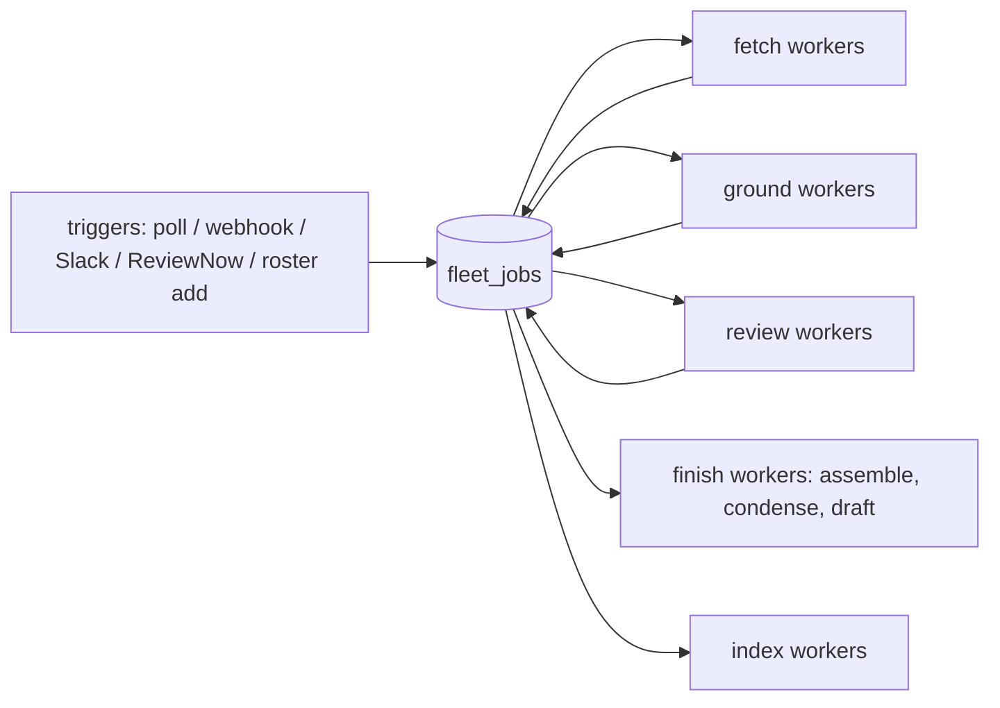

# 06 — Work queues and worker pools: many repos, many PRs

The fleet has to keep up with a large roster (hundreds of repos), some of them very
busy (nixpkgs: ~12.7k open PRs, hundreds of pushes a day), without a slow repo or a
burst on one repo starving the rest. Today it can't: one slow nixpkgs fetch stalls
every other repo for up to 10 minutes (l2, 2026-11-02). This doc replaces the single
drain loop with **durable, staged work queues** drained by **configurable worker
pools**, and makes the fleet scale out across processes.

## Today

- Triggers (forge poll, webhook, Slack, `ReviewNow`) go onto one in-memory, bounded,
  coalescing `TriggerQueue` (`crates/agent-review-fleet/src/orchestrator.rs:134`, cap
  `FLEET_TRIGGER_QUEUE_CAP` = 256, `crates/agent-cli/src/grpc_server.rs:1214`).
- **One** drain task (`grpc_server.rs:1354`) `await`s `orch.handle(trigger)` per trigger.
  `handle` (`orchestrator.rs:592-862`) runs all the prep inline: factory build, mirror
  refresh and `fetch_pr` (each bounded by `PREP_TIMEOUT` = 300 s, `:320`), worktree,
  grounding (collectors, analyzers — up to minutes). Only the model review is spawned
  (`:862`); its concurrency is capped by the `SessionManager` (`[review_fleet]
  max_total` / `max_per_user`, `crates/agent-runtime/src/config.rs:198-204`).
- So the effective parallelism of everything **before** the LLM is 1, the queue is
  lost on restart, and a fleet can't be spread over several processes or pods.

## Goals

1. **Parallel, isolated stages.** Fetch, ground, review, assemble/condense and index
   each run on their own worker pool; a slow stage or a slow repo only delays itself.
2. **Configurable workers** per stage (and per host), changeable without a code edit.
3. **Fairness**: round-robin across tenants, then repos, so one busy repo (nixpkgs) can't
   take all the workers; per-repo and per-tenant concurrency caps.
4. **Durable and restart-safe**: a queued or in-flight job survives a crash; a dead
   worker's job is retried by another (leases + heartbeats), at most N attempts.
5. **Horizontal scale**: several `--serve-fleet` processes (k8s replicas) share one
   queue; any worker can take any job, except where the job is bound to local disk
   (see *Locality*).
6. **Coalescing**: a new push supersedes a queued job for the same PR; only the newest
   head is ever worked.
7. **Observable**: depth, age and throughput per stage, tenant and repo; the portal shows
   where each PR is.

## Model



A **job** is one stage of one PR (or one repo, for indexing). Finishing a stage enqueues
the next stage's job. Stages:

| Stage | Work | Bound by | Default workers |
|---|---|---|---|
| `fetch` | mirror refresh of the target ref, `fetch_pr`, worktree | network / forge rate limit | 8 |
| `ground` | collectors and analyzers (the brief) | CPU, disk | 4 (≈ cores / analyzer parallelism) |
| `review` | the review graph's LLM steps ([02](02-pipeline-executor.md)) | model capacity | `[review_fleet] max_total` (as today); the config below overrides it |
| `finish` | assemble, condense, render, record the draft | model capacity (short) | 4 |
| `index` | onboarding index / refresh ([04](04-repo-knowledge.md)) | CPU, disk | 1, low priority |

Config:

```toml
[review_fleet.queue]
backend = "postgres"          # "memory" (single process, the default) | "postgres"
max_attempts = 3
lease_secs = 120              # a worker heartbeats every lease_secs / 3
[review_fleet.queue.workers]  # per process
fetch = 8
ground = 4
review = 16                   # unset: [review_fleet] max_total. Effective concurrency is
                              # min(workers.review × max_parallel_steps, max_total): workers
                              # never bypass SessionManager admission, they wait on it
finish = 4
index = 1
[review_fleet.queue.fairness]
per_repo = 2                  # most jobs of one repo in flight per stage
per_tenant = 8
```

A row can override `per_repo` (nixpkgs might get 4 fetches but 2 reviews).

## Claiming, fairness and priority

- Workers claim with **`FOR UPDATE SKIP LOCKED`**, the same one-statement claim and lease
  the campaign driver already uses (`crates/agent-campaign/src/postgres.rs:23,1266`,
  `claimed_by` / `lease_until_ms`). The memory backend implements the same trait for
  single-process fleets and tests.
- **Fair order**: among ready jobs of a stage, pick the tenant with the fewest in flight,
  then within it the repo with the fewest in flight, then priority, then age. Jobs over
  the `per_repo` / `per_tenant` caps are skipped, not blocked on.
- **Priority**: `ReviewNow` > webhook > poll > index refresh. A small or new PR can be
  boosted later; not in the first cut.
- **Coalescing**: the queue keeps one live job per `(row, pr)` across all stages, plus a
  nullable `pending_head_sha` column on it. When a trigger arrives:
  - **No live job:** insert a `fetch` job for the new head.
  - **Live job queued (`ready`):** replace its `head_sha` in place and reset it to
    `stage = fetch`. Same head: no-op. Resetting from a later stage (say a job queued at
    `review` after `ground` finished) deliberately discards the grounded work, because a
    new head invalidates it. Every stage output (worktree, brief, lens outputs) is keyed
    by `head_sha`, so nothing from the old head can leak into the new one.
  - **Live job in flight (`claimed`):** set `pending_head_sha = <new head>`, last writer
    wins. The worker isn't interrupted.

  When a worker finishes a stage, in the same transaction that would enqueue the next
  stage, it checks `pending_head_sha`. If it is set, the finished job is marked
  `superseded` and a fresh `fetch` job for the pending head is enqueued (with
  `pending_head_sha` cleared), so the newer push is never lost. A lease that expires while
  `pending_head_sha` is set restarts at `fetch` with the pending head.

## Locality

Fetch, ground and finish read the row's mirror and worktree on local disk. Two options,
picked per deployment:

- **Single host (l2, now)**: everything is local; stages just need their own pools.
- **Many hosts**: a job carries the host that holds the worktree (`affinity`), and only
  that host's workers claim the next stage; if the host dies the lease lapses and the
  chain restarts from `fetch` on another host. Mirrors are per host (a shared mirror on
  network storage is out of scope). The `review` stage needs only the brief and
  read-only tools on the worktree, so it is affine too until the tools can read over a
  file service.

## Failure and back-pressure

- A stage error is retried with `agent-retry` backoff up to `max_attempts`, then the PR is
  marked `failed` with the reason (visible in the portal); a later push re-enqueues it.
- `PREP_TIMEOUT` stays per operation, but now only ties up one fetch worker.
- When a stage's queue is deeper than a high-water mark, the poller stops enqueuing that
  repo's poll triggers (webhooks and `ReviewNow` still enqueue), so a 12k-PR repo can't
  flood the table; the `forge-good-citizen` pacing (#679) keeps the forge calls polite.
- Graceful shutdown stops claiming, lets in-flight jobs finish up to a deadline, then
  releases their leases.

## Data

`fleet_jobs` (Postgres, via the config store like the roster and the post lease):
`id`, `tenant`, `row_id`, `repo`, `pr`, `head_sha`, `stage`, `priority`, `state`
(`ready|claimed|done|failed|superseded`), `attempts`, `claimed_by`, `lease_until_ms`,
`affinity`, `pending_head_sha` (see *Coalescing*), `enqueued_at`, `updated_at`, `error`.
Unique `(tenant, row_id, pr)` while live, as a partial unique index
`WHERE stage <> 'index' AND state IN ('ready','claimed')`. Index jobs have `pr = NULL`, and
`NULL` never conflicts in a Postgres unique index. So they get their own partial unique index
`(tenant, row_id) WHERE stage = 'index' AND state IN ('ready','claimed')`, with a
`corner_two_index_triggers_one_job` test row. Finished jobs are kept for a short window for the portal, then pruned.
Every field from a trigger is untrusted: ids pass `safe_segment`, numbers are clamped,
`error` is length-capped.

## Observability

- `agent_fleet_queue_depth{stage,tenant,repo}`, `agent_fleet_queue_wait_seconds{stage}`
  (enqueue → claim), `agent_fleet_stage_seconds{stage,outcome}`,
  `agent_fleet_workers_busy{stage}`, retries and supersedes per stage.
- Spans: one `fleet.job` span per stage, linked by the PR's trace id.
- Portal: the Fleet tab's roster card shows queued / in flight per stage, and each PR
  row shows its current stage.

## Increments

This becomes increment **1b**, after the nixpkgs fetch fix (1):

- **1b-i.** In-process stage pools over the existing memory queue: the drain loop only
  routes; per-stage worker counts and per-repo caps from config. Removes the head-of-line
  blocking on one host with no schema change.
- **1b-ii.** The `FleetJobQueue` trait with memory and Postgres backends; leases,
  heartbeats, retries, coalescing; restart-safe.
- **1b-iii.** Multi-process: affinity, graceful shutdown, k8s replicas; portal stage view.

Test tables (rstest, four classes + adversarial): a hung repo doesn't delay another; the
per-repo cap holds under a 1,000-PR burst; a newer head supersedes a queued job; a newer head arriving while a stage is in flight is
recorded in `pending_head_sha` and becomes a fresh `fetch` job when the stage ends (never lost);
over the high-water mark, poll triggers for that repo are dropped while webhook and `ReviewNow`
triggers still enqueue; a dead
worker's lease lapses and another worker finishes the job; two processes never claim the
same job; max attempts ends in `failed`; adversarial ids and huge PR numbers rejected.

## Open questions

- Should the `review` stage become remote-capable (tools over gRPC) so model work can run
  on any host? Defer until the single-host pools are measured.
- Fairness weights per tenant (paid tiers) — out of scope now.
